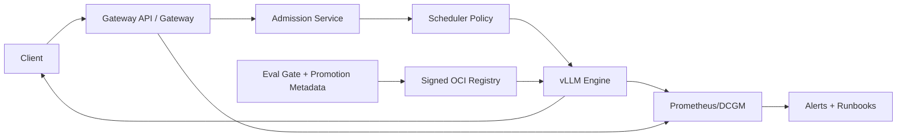

# Architecture

This repository has three layers:

```text
docs/      reference and operating model
playbook/  validation contracts, profiles, schemas, runbooks
impl/      deployable implementation scaffolds
```

## Control Plane

```text
GitOps / Helm values / secrets
  -> Helm charts
  -> Gateway policy
  -> Admission and scheduler policy
  -> Observability and governance metadata
```

Control-plane components:

- Gateway API / gateway controller
- admission service
- scheduler policy primitives
- KEDA scaling config
- model registry and promotion metadata
- Prometheus/Grafana/OTel

## Data Plane

```text
client
  -> gateway
  -> admission / policy
  -> endpoint picker / scheduler policy
  -> vLLM engine pod
  -> streamed response
```

Data-plane responsibilities:

- auth/tenant resolution at the gateway
- pre-engine token and quota admission
- alias translation to served model name
- priority class propagation
- cancellation propagation
- engine serving and metrics

## Repo Layer Responsibilities

| Layer | Owns | Does not own |
|---|---|---|
| `docs/` | reference design, decisions, caveats | deployment |
| `playbook/` | Make targets, schemas, validation contracts | real infra |
| `impl/` | charts, service scaffolds, policy modules | environment values |

## Implemented Components

| Component | Path | Status |
|---|---|---|
| Engine chart | `impl/charts/inference-engine` | scaffold |
| Gateway chart | `impl/charts/gateway` | scaffold |
| Admission service | `impl/gateway/admission` | local unit covered |
| Scheduler primitives | `impl/scheduler` | library scaffold |
| Observability chart/assets | `impl/charts/observability`, `impl/observability` | scaffold |
| Governance | `impl/governance` | scaffold |
| Guardrails | `impl/guardrails` | scaffold |
| Frontier fabric | `impl/fabric` | scaffold |

## User-Provided Systems

- Kubernetes cluster with GPU nodes
- Gateway API controller
- private OCI registry
- secret manager / External Secrets
- Prometheus/Grafana/OTel or managed equivalents
- model artifacts and signing keys
- live staging environment for validation

## Mermaid Overview


